# Problem Set 4 Student Submission

**Student:** Yike Cheng (`yikecheng`)  
**GitHub repository:** https://github.com/yikecheng/ps04 (public fork)

This is the final submission record. The repository, articles, audience videos, and technical demonstration are published and cross-linked below.

## Topic and Audience

- **Publication name:** Agent Signal
- **Topic:** Evidence-based adoption of AI coding agents by small software teams.
- **Audience and assumed knowledge:** Technical leads and hands-on engineering managers at teams of roughly 2–20 people who understand pull requests, CI, testing, and code review.
- **Central question:** Which new coding-agent capabilities are genuinely production-ready, what evidence supports the claims, and what should a small software team do next?
- **Scope and exclusions:** The series covers delegation, context and harness design, verification, security, cost, team workflow, and maintenance. It excludes generic AI news, model-release scorekeeping without workflow implications, beginner prompting tutorials, investment speculation, and claims without a verifiable date or supporting passage.
- **Reason for readers to return:** Each run converts a fresh 30-date evidence window into three practical layers: what changed, what survives scrutiny, and what a small team should do next. Vendor announcements, independent research, and practitioner evidence remain visibly distinct.

## Published Series

The three reviewed article/video pairs are publicly accessible. The YouTube videos are unlisted, as permitted by the assignment, so anyone with the link can view them.

| Piece | Title | Substack article | YouTube video |
| --- | --- | --- | --- |
| 1 | The Agent Moved Past the Diff, Not Past the Gate | [Read on Substack](https://ekc1586677.substack.com/p/the-agent-moved-past-the-diff-not) | [Watch on YouTube](https://youtu.be/Z2KrAwjo1DY) |
| 2 | Production-Ready Is a Measurement Claim | [Read on Substack](https://ekc1586677.substack.com/p/production-ready-is-a-measurement) | [Watch on YouTube](https://youtu.be/U6wtQDe2PJ8) |
| 3 | Earn the Next Rung | [Read on Substack](https://ekc1586677.substack.com/p/earn-the-next-rung) | [Watch on YouTube](https://youtu.be/5j9XWXjS47A) |

**Separate 4–6 minute technical demonstration:** [Agent Signal — Technical Demonstration](https://youtu.be/N_G09Ix0UjU) (5:42, unlisted YouTube).

All four videos use synthetic text-to-speech narration under the course's approved TTS alternative. Each video discloses the synthetic narration and AI assistance; the approved editorial conclusions remain fingerprint-bound to Yike Cheng's recorded human review. English is set as the video language, and YouTube Studio reports a published automatic-caption track for all four videos. Reproducible narration scripts, visual directions, descriptions, thumbnails, and local SRT sidecars are retained or generated by the repository workflow.

## Setup and Execution

See also `docs/SETUP.md` and `docs/ARCHITECTURE_IMPLEMENTATION.md` for a concise grader-facing implementation guide.

The project was exercised on macOS with Bash and Python 3.10. It requires an authenticated Codex CLI for the live editorial stages. Network collection uses Python's standard library plus the explicit CA bundle in `certifi`; YouTube transcript retrieval uses `youtube-transcript-api` with `yt-dlp` as fallback. The exact Python dependencies are pinned by compatible ranges in `requirements.txt`.

```bash
bash setup.sh
bash run.sh
```

`setup.sh` creates `.venv` and installs the dependencies. Each Bash entrypoint automatically prefers that environment when present. The model provider defaults to the logged-in Codex account. Optional configuration variables are:

- `PS04_MODEL_PROVIDER=codex` — the only supported live provider.
- `PS04_MODEL=<model-name>` — optional explicit model; omission records `account-default`.
- `PS04_EVIDENCE_DIR=<path>` — optional alternate evidence-store path, primarily for isolated tests.

No API secret is stored in this repository. `config/project.json` defines the publication, topic, audience, and question. `config/sources.json` defines real feed, YouTube, podcast, and documented fallback sources. `config/editorial_policy.md` and the four files under `prompts/` control selection, brief creation, and paired article/video-script generation. Each live run snapshots all of these inputs before doing work.

Useful verification and replay commands are:

```bash
python3 -m unittest discover -s tests -v
bash data/store.sh list
bash processing/filter_items.sh runs/RUN_ID < runs/RUN_ID/corpus.jsonl
bash editorial/select_items.sh runs/RUN_ID < runs/RUN_ID/eligible.jsonl
bash review/check_content.sh runs/RUN_ID
bash reporting/summarize_run.sh runs/RUN_ID
bash run.sh --package runs/RUN_ID
```

The final command is allowed to package only a passing review whose `review_id` exactly matches a genuine student-supplied `approval.json`; it does not recollect or rewrite approved drafts.

## Architecture and Manual Handoffs

```mermaid
flowchart LR
    R[run.sh] --> C[3 collectors]
    C --> E[extract text and timestamped transcripts]
    E --> S[(versioned SQLite evidence index)]
    S --> F[30-date mechanical filter]
    F --> G{coverage gate}
    G --> A[AI accept / reject / defer]
    A --> B[3 evidence-linked briefs]
    B --> W[3 articles]
    B --> V[3 video scripts]
    W --> Q[mechanical content review]
    V --> Q
    Q --> H[student editorial approval]
    H --> P[immutable production package]
    P --> MR[local media renderer + TTS]
    P --> SS[Substack]
    MR --> YT[YouTube]
```



The 16 required Bash files remain separate entrypoints with the responsibilities specified in `ARCHITECTURE.md`; focused Python helpers implement parsing, storage, coverage, receipts, and structured model calls. Candidate and item streams are JSON Lines. `data/store.sh` alone accesses the persistent SQLite index. Source text and timestamp segments are content-addressed under `data/assets/`; retrieval time is excluded from the substantive version hash. Every invocation writes a non-overwriting receipt under the run's `logs/` directory, and every model call retains its request, output schema, event stream, response, model name, token usage, and unknown cost.

The three honest handoffs are complete:

1. **Editorial approval (complete):** Yike Cheng inspected the review packet and stated, “I reviewed the packet and approve the recommendations.” The exact fingerprint-bound decision is retained in `approval.json`; automation did not manufacture this judgment.
2. **Video production (complete):** the reviewed scripts were rendered locally into three 3–5 minute audience videos and one 5:42 technical demonstration using offline synthetic TTS, source cards, and explicit AI-use disclosure. The generation script and media manifest make the build repeatable; the four uploaded files passed duration, audio, and visual spot checks.
3. **Publication (complete):** all three articles were published on Substack for everyone, all four videos were uploaded to YouTube as unlisted, each article/video pair was cross-linked, English captions were verified, and the exact URLs were recorded in `runs/20261013T231400Z-55620c5a/package/publication_links.json` and `docs/PUBLICATION_VERIFICATION.md`.

## Evidence and Runs

The retained runs are repository-relative and self-contained; all referenced `text_path` and `segments_path` values resolve to immutable files under `data/assets/`.

| Run | Actual date (UTC) | Result and artifacts | Elapsed time | Approximate cost |
| --- | --- | --- | --- | --- |
| Diagnostic live run `20261013T224738Z-f3b9709b` | 2026-10-13 | Failed honestly after partial collection; preserves TLS failures, broken YouTube feed endpoints, inaccessible full text, one missing transcript, repeated recovery attempts, and 11 stored items | 185.215 s | Unknown |
| First completed live run `20261013T231400Z-55620c5a` | 2026-10-13 | `summary.json`, 17 eligible items, 9 independent publishers, 10 accepts, 6 rejects, 1 defer, 3 briefs, 3 articles, 3 scripts, passing `review.json`, and an approved immutable production package | 1,292 s generation; 244,900 s through the later human-approval/package handoff | Unknown; account-default Codex did not report dollars |
| Second live run `20261016T021442Z-113efa68` | 2026-10-16 | 27 observations; 10 new, 5 changed, 12 unchanged; 25 eligible items from 10 publishers. Generated 3 briefs/articles/scripts under policy v2 but correctly failed final review because no accepted podcast entered the new briefs. See `docs/SECOND_LIVE_RUN.md`. | 1,237 s | Unknown; account-default Codex did not report dollars |

The first completed run contains 8 feed items, 6 YouTube videos, and 3 podcast episodes. Six items were new and 11 were unchanged from the earlier live attempt, demonstrating persistent deduplication and replay without duplicate evidence versions. `filter_items` rechecked all 17 stored items against the inclusive `D-29` through `D` UTC window; all were eligible. The failed run's receipts preserve the initial certificate errors and later recovery through an explicit CA bundle, while the source configuration records the verified direct-video fallback used after YouTube channel-feed endpoints returned 404/500 errors. These are real live failures, not simulated fixtures.

The later live run demonstrates actual update behavior: 10 new items were inserted, 12 observations remained unchanged, and 5 material versions changed. The moving window excluded two September 14 items as `outside_window`. A sandbox-blocked model invocation was retained, then the affected editorial workflow was resumed successfully. Policy v2 accepted neither eligible podcast, so the series-level check stopped rather than silently using rejected evidence. The original complete run remains the production candidate.

The completed run records 4,650,834 input tokens, 4,294,784 cached-input tokens, 78,491 output tokens, and 49,410 reasoning-output tokens. Monetary cost remains unknown because the logged-in account-default CLI did not return per-call pricing; the summary's `$0` aggregate is only the sum of known receipt costs and is not a claim of zero spend.

### Claim trace

For Piece 2, claim `02-c9` says that Joy Ebertz asked an agent to fix a test, the agent deleted it, and her team added guidance not to delete tests.

- **Draft:** `runs/20261013T231400Z-55620c5a/articles/02.md`, under the exact marker `<!-- claim:02-c9 -->`.
- **Brief:** `runs/20261013T231400Z-55620c5a/briefs.jsonl`, claim `02-c9`.
- **Editorial decision:** `runs/20261013T231400Z-55620c5a/decisions.jsonl`, accepted item `podcast:infoq:5925e1fbf36f4960a85e` as bounded practitioner evidence.
- **Immutable source version:** `v-fa6a1a051450d1962bb56646`.
- **Exact retained passage:** segments `seg-0060` through `seg-0063` in `data/assets/podcast-infoq-5925e1fbf36f4960a85e/v-fa6a1a051450d1962bb56646.segments.json`, mapped to 13:35–14:31 and explicitly labeled `estimated_from_duration`.
- **Publisher transcript:** the article links directly to InfoQ's transcript page. Extraction v2 recognizes the publisher's spaced section timestamps and labels paragraph-level interpolation; the second run preserved that corrected source-derived version without rewriting this first-run evidence.

Large original audio/video files are not required to inspect a claim and are not committed. The source URL, native media ID, publication metadata, full retained transcript, timestamped segments, and deterministic content version are preserved. A reviewer can retrieve the original media from each item's `url` or `media_url`.

## Editorial Review

The first completed run snapshots editorial-policy version 1 at `runs/20261013T231400Z-55620c5a/config/editorial_policy.md` and retains the exact prompts under that run's `prompts/` directory. `runs/20261013T231400Z-55620c5a/human_review.md` compares the AI's reasoning with proposed student judgments for three accepted items and three rejected/deferred items:

- Accept AgentSWE, bounded to its 25 commissioned tasks and held-out protocol.
- Accept Sourcegraph's workflow scope, but not merged-change volume as proof of effectiveness.
- Accept Joy Ebertz's interview as practitioner evidence, not prevalence data.
- Reject GitHub's model-availability announcement because it gives no inspectable production outcome.
- Reject IBM's generic explainer because its large speed claims lack inspectable tasks and outcomes.
- Defer Simon Scrapes' numerical improvement claims until their primary source, product version, and method are inspectable.

Version 2 adds four operational rules: vendor announcements establish availability rather than readiness; quantitative claims retain or name missing denominator/baseline/task/outcome fields; activity and efficiency metrics remain separate from accepted outcomes; and creator-reported numerical improvements are deferred when their primary method is not inspectable. The full second live run used v2. A controlled rerun also applies v2 to the exact original evidence cohort so policy effects are not confused with new or changed sources. On 2026-10-16, Yike Cheng stated, “I reviewed the packet and approve the recommendations,” confirming review fingerprint `review-8f4ee1be1e8599b656e3fed9`. The matching package was created without rewriting the approved drafts, and the run status is now `ready_for_production`. The scope and remaining limitations are recorded in `docs/FINAL_REVIEW.md`.

## Reflection

The most useful insight was that apparently conflicting evidence often measures different layers. Cursor measured harness efficiency, Sourcegraph reported human-gated activity, AgentSWE tested frozen delivery fidelity, and practitioners described test-integrity and architectural failures. A team can improve cost or throughput while accepted outcomes stay flat or worsen. “Production-ready” is therefore a measurement claim, not a product label.

The clearest editorial failure was that a fresh announcement initially looked valuable merely because it was recent. The selection pass correctly rejected it when it established only model availability and admin controls, not task outcomes. A second limitation is the lack of head-to-head small-team evidence on identical tasks, repositories, supervision, and acceptance criteria. The next improvement would be a small reproducible local pilot suite that adds defect, rework, review-time, rollback, and maintainability outcomes to the external evidence.

The main architectural tradeoff is a lightweight local SQLite index plus immutable text/segment assets instead of a hosted search or vector database. This makes replay, version history, exact claim inspection, and grading simple, deterministic, and credential-free. It gives up semantic retrieval at larger scale, but 12–30 evidence items per run do not justify the extra infrastructure or opaque retrieval behavior.
