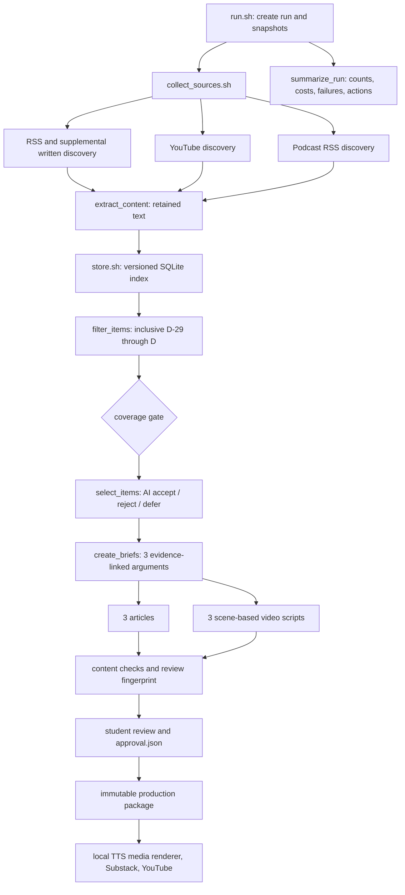

# Agent Signal implementation architecture

The supplied `README.md` and `ARCHITECTURE.md` remain course contracts. This document describes the implementation behind them.

## Boundaries

Bash owns orchestration and the required component interfaces. Focused Python modules implement parsing, storage, filtering, coverage, structured model transport, checking, packaging, and reporting. No wrapper delegates the whole pipeline to a single application. `data/store.sh` is the only entrypoint that accesses `data/evidence/`.

AI judgment is bounded to selection, synthesis, and drafting. JSON schemas constrain output shape; deterministic checks verify item coverage, exact evidence references, source counts, date windows, claim markers, word ranges, and review fingerprints. These checks do not establish truth or fair interpretation, which is why packaging requires a matching student-supplied approval.

## Storage and replay

Stable item IDs identify underlying material. Version IDs hash evidence-relevant metadata, text, and transcript segments but exclude retrieval time. Text and timestamp arrays are immutable under `data/assets/`; SQLite stores current and historical versions plus run observations. Unchanged candidates can reuse stored extraction only when their metadata and extractor version match.

The tradeoff is intentional: SQLite and content-addressed files are easier to inspect and reproduce than a hosted search or vector system for a weekly corpus of roughly 12–30 items. The design gives up semantic retrieval at scale in exchange for exact provenance, deterministic replay, and credential-free grading.
